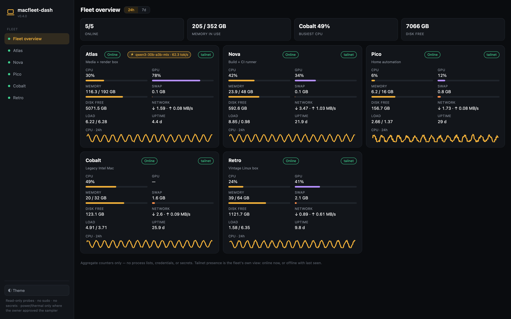
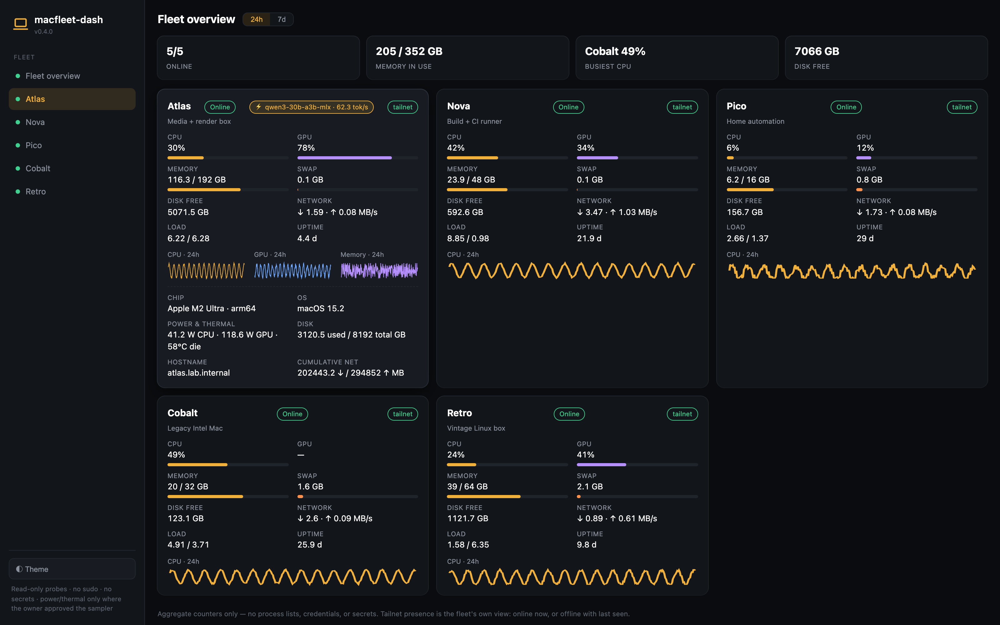

# macfleet-dash

[](https://github.com/sgtworkman/macfleet-dash/actions/workflows/ci.yml)
[](LICENSE)

sparkDash-style health dashboard for a fleet of Macs — Apple Silicon + Intel,
macOS + Linux, zero sudo, zero dependencies.

**Viewer release v0.9.4.** The health collector and probe remain v0.6.0;
their existing protocol and running services are unchanged. See the
[change log](CHANGELOG.md) and [release notes](https://github.com/sgtworkman/macfleet-dash/releases/tag/v0.9.4).

The screenshots below are synthetic examples from the earlier viewer.
Versions 0.7.0+ use resource bars and hourly history instead of overview CPU lines.



One small collector polls every Mac you register, one probe script answers on
each of them, and a static viewer shows CPU, GPU, memory, swap, disk,
network, load and uptime per host — with clear resource bars, focused details,
24-hour and 7-day hourly activity, a ⌘K command palette, dark/OLED/light themes,
serving-model state (with an opt-in end-to-end completion benchmark), tailnet presence, and Time Machine backup health on
macOS. The Mac/Linux collector uses the Python 3.9+ standard library only:
no node_modules, no build step, and no third-party core runtime packages.
The optional Windows client uses existing `pywinrm` and `python-dotenv` packages;
it does not add dependencies to the original collector or Windows hosts.

Focused host detail — full metrics, optional hourly history, benchmark rate and (where the
owner approved a sampler) power/thermal:



```
macfleet-dash/
├── probe/fleet-probe.sh        POSIX probe — answers on macOS AND Linux
├── endpoint/metrics_server.py  read-only /metrics.txt endpoint (for hosts without SSH)
├── endpoint/install.sh         macOS LaunchAgent installer for the endpoint
├── collector/macfleet.py       collector: probes, parses, rates, history, serves viewer
├── viewer/index.html           static dashboard shell
├── viewer/fleet-app.mjs        rendering/controls; reads local snapshots only
├── viewer/fleet-model.mjs      validated metrics and fixed-scale hourly history
├── collector/token_usage.py   aggregate-only read of local Hermes usage
├── collector/publish_token_usage.py  private token snapshot; existing WCC cadence
├── collector/model_status.py  bounded read-only current-model metadata
├── collector/windows_snapshot.py  optional encrypted private WinRM bridge
├── windows/                   reviewed local Windows collector and validator
└── tests/test_parse.py        fixture-based unit tests (stdlib unittest)
```

## Quickstart

New installation? Open **Setup & connections** in the viewer. With no published
computers, the overview shows this setup screen automatically instead of an
endless loading message. **Download starter config** creates a configuration
for only the Mac or Linux computer running the collector. Do not replace an
existing configuration. The downloaded app has no operator inventory or live
readings; connect your own authorized computers using the steps below.

**Check connection** re-reads this installation's published snapshots and shows
valid, missing or invalid sources, responding computers and pending inventory.
It does not probe a remote computer, install software or establish access.
An optional Windows/token source can be unconfigured without blocking Mac setup.

**1. Install the probe on each Mac** — copy `probe/fleet-probe.sh` to the host
(or leave it where the collector can push it). The collector sends the script
over SSH stdin, so nothing needs to be installed for SSH hosts at all.
For hosts reached by HTTP instead (restricted SSH, forced-command only), run
the endpoint there:

```sh
# on that Mac — binds 127.0.0.1:8791 by default; pass your tailnet IP to publish
./endpoint/install.sh 100.64.0.5:8791     # macOS LaunchAgent (com.macfleet.metrics); 100.64.0.5 = this Mac's Tailscale IP
# or by hand, any platform:
python3 endpoint/metrics_server.py 100.64.0.5:8791
```

Verify it answers: `curl http://<bind>:8791/metrics.txt` — you should see
`PROBE_OK=1` and a dozen KEY=VALUE lines.

**2. Register your hosts** — `macfleet.toml` in the repo root (or pass
`--config`):

```toml
interval = 300   # seconds between cycles, if you drive it from cron/launchd

[hosts.mini1]
method = "ssh"                # BatchMode + ConnectTimeout=8, no sudo, no agents
host = "you@mini1"           # anything ssh(1) accepts, incl. ~/.ssh/config aliases
role = "Services · sparkDash host"

[hosts.localhost]
method = "local"              # probe this machine directly

[fleet]
tailnet_presence = true
tailnet_via = "mini1"   # optional: read the peer map from this ssh host (works under launchd)

[hosts.macstudio]
method = "http"               # restricted SSH? poll its metrics endpoint
url = "http://100.64.0.5:8791/metrics.txt"   # endpoint Mac's Tailscale IP
role = "Local AI · vision and text"  # saved description, not model detection

[hosts.legacy-box]
method = "ssh"
host = "mbp2013"              # the 2013 MacBook — Linux (Omarchy) works too
```

`macfleet.json` works identically if you prefer JSON.

**3. Run the collector** and open the viewer:

```sh
python3 collector/macfleet.py --live          # one cycle; prints a summary table
python3 collector/macfleet.py --serve 8780    # serves viewer/ on http://127.0.0.1:8780
```

For a standing dashboard, schedule a cycle every few minutes and keep the
viewer up:

```sh
# crontab -e : 5-minute cycles
*/5 * * * * cd /path/to/macfleet-dash && python3 collector/macfleet.py --live >/dev/null 2>&1
# then leave this running (launchd KeepAlive or a plain shell):
python3 collector/macfleet.py --serve 8780
```

**4. Check your work:**

```sh
python3 -m unittest discover -s tests -p 'test_*.py'  # fixture tests; no network
python3 collector/macfleet.py --selftest
node --test tests/*.test.mjs         # development checks; Node 22+, not a runtime dependency
```

Collector flags: `--live` (probe now — nothing is probed without it),
`--json` (payload to stdout), `--serve PORT [--bind IP]` (viewer), `--config`,
`--state`, `--selftest`. State lives in `state/macfleet-state.json`
(override with `--state` or `MACFLEET_STATE`); the viewer reads
`viewer/data.json`, rewritten atomically every cycle. 288 cycles (24 h at a
5-minute cadence) of per-host history are kept, plus bounded 7-day history.

## Locations

Open **Locations** in the sidebar or the command palette to assign your own
location names to Mac, Linux, Windows and pending inventory entries. Labels
can be Home, Office, a store name, or another name you choose; no IP address
is used to guess a physical location. Blank means Unassigned.

Every computer's details include **Edit location**, which opens and focuses its
location field. Select several computers and use **Apply to selected** to stage
a bulk draft; this does not save it. Choose one of the options below afterward.
Unsaved individual and bulk edits survive a normal data refresh.

- **Save only in this browser** stores overrides in this browser's local storage.
  They survive a page reload but do not change another browser or the server.
  Storage failures are shown as errors, never as successful saves.
- **Download shared config** downloads `fleet-locations.json`. On the computer
  hosting your installation, apply it from the MacFleet folder:

  ```sh
  python3 collector/configure_locations.py --import /path/to/fleet-locations.json
  ```

  Replace the path with the downloaded file. The command updates only location
  fields in private `viewer/fleet-registry.json`, preserves existing metadata
  and pending inventory, and backs up the previous file under private
  `state/location-backups/`. Refresh the viewer; no service restart is required.
  Browser overrides take precedence until **Reset browser overrides** is used.

You can also assign shared locations directly, including before a new host is
connected. The IDs are the keys you chose in `macfleet.toml` or your Windows
configuration, not a guessed hostname:

```sh
python3 collector/configure_locations.py --set localhost Home --set mini1 Office
```

[`fleet-locations.example.json`](fleet-locations.example.json) is a generic
template. Exported settings contain computer IDs and labels only. Keep your
own settings and registry private; no real inventory is included in the release.
To undo a shared change, restore the exact previous registry from the backup
path printed by the command, then refresh. No telemetry, identity, enrollment,
credentials, network policy or collector configuration is changed.

## Current model · v0.9.4

Computer cards and details show **Current model** separately from the saved
computer role and the optional historical performance benchmark. A model is
current only after a fresh, singleton llama.cpp `/v1/models` response. The
optional `/props` response supplies the artifact filename and active context
per slot; full private filesystem paths are discarded. Quantization and model
parameter count come from reported metadata. Missing values stay unknown.
A catalog from another server, multiple model IDs, an endpoint failure or a
check older than 10 minutes is explicitly unverified, not a guessed active model.

Opt in using your own existing private endpoint in `macfleet.toml` or JSON:

```toml
[hosts.my-ai-computer]
method = "http"
url = "http://100.64.0.5:8791/metrics.txt"
role = "Local AI · vision and text"
ts_ip = "100.64.0.5"
model_url = "http://100.64.0.5:8000/v1/models"
bench = false
```

Use the real port of your already-running llama.cpp server. Only explicit
loopback, RFC1918, Tailnet or private IPv6 IPs are accepted; DNS discovery,
credentials, URL queries, redirects and proxies are not used. If `ts_ip` is
provided, the model endpoint must be on that registered computer. Up to eight
configured endpoints are checked, with four concurrent readers, two-second
request timeouts and bounded response sizes. Other model engines/catalogs
remain unverified rather than being mislabeled as a loaded model.

The existing optional snapshot command now publishes private mode-0600
`viewer/model-status.json` alongside token usage:

```sh
python3 collector/publish_token_usage.py --viewer-port 8780 --config ./macfleet.json
```

Use your own configuration path and the port of your existing loopback viewer.
An established WCC refresh already invokes this helper on its normal cadence;
no scheduler or service restart is added. Standalone installations must call
the helper from their own existing refresh schedule. One successful manual
check is not automatic-monitoring proof. The viewer only reads same-origin
snapshots; it does not contact AI servers or send prompts. Current-model checks
never load/unload models, run generation benchmarks or change serving context.

To correct an outdated saved Mac/Linux role without reloading its collector,
set that computer's `role` text in your private `viewer/fleet-registry.json`.
This is descriptive metadata only; it never substitutes for a model response.
Preserve existing registry fields. Runtime configuration, model snapshots and
actual computer/model inventory are never included in public releases.

## Recent activity and application changes

Open **Recent activity** from Workspace, the overview or computer details.
Connection-reading changes, important alerts and effective location changes
are observed while this browser is open. The first snapshot establishes a
baseline: no earlier history is fabricated. Up to 200 events are retained in
browser-local storage under `macfleet-activity-v1`. No raw health snapshot,
credential or endpoint is saved in this journal. If storage fails, the screen
discloses that activity is session-only rather than claiming it persisted.

This is not a complete unattended or cross-browser audit log. Event time is
when this browser observed the change, not a source computer's clock. Numeric
metric fluctuations do not repeatedly log the same alert; a stale source never
becomes proof that the computer is powered off. Source failures remain visible.

**Application changes** separately lists generic versioned changes, their date
and time, and their author/agent. Source preparation and GitHub publication are
identified separately; a note is not proof of deployment to another host.
Private computer activity and inventory are never included in public notes.

## Public release checks

In addition to tests and secret scanning, inspect the actual source archive:

```sh
python3 collector/check_release.py /path/to/macfleet-dash-v0.9.4.tar.gz
```

The check rejects runtime snapshots, private configuration, exported location
settings, local state, archive links/path traversal and incomplete viewer files.
CI performs this check against a real Git archive, not just `.gitignore`.
Before release, also open a clean extracted copy without operator settings and
verify the first-computer setup, connection check, location controls and activity
on desktop and mobile. Keep test telemetry synthetic and outside public source.
To roll back a viewer update, restore the prior release's source files while
preserving all private configuration and runtime state, then refresh browsers.
No health-collector or receiver restart is required for this viewer update.

## Security model

- **Tailnet-bound.** The HTTP endpoint has no authentication — bind it to a
  loopback or tailscale address only. `metrics_server.py` warns and
  `install.sh` documents this; the server never binds 0.0.0.0 by default.
- **Read-only.** The probe runs `sysctl`, `ps`, `top -l`, `ioreg`, `vm_stat`,
  `netstat -ib`, `df -k`, `uptime`, `tmutil` (destination info + latest backup
  lookup only — never starts or deletes a backup) and their `/proc`-based
  Linux equivalents.
  It reads aggregate counters only: no process lists, no file contents, no
  credentials, nothing that needs sudo. The collector's SSH use is
  `BatchMode=yes` with `ConnectTimeout=8` — key-based, non-interactive, no
  password prompts, no agent hacks.
- **No secrets.** The viewer fetches only local `data.json`, `token-usage.json`,
  `windows.json`, `tailnet-windows.json`, `model-status.json` and `fleet-registry.json`.
  The collector talks only to registered hosts. An already opted-in benchmark
  sends one fixed short completion; it is not passive traffic measurement.

## Supported probes

| Metric | macOS (Apple Silicon + Intel) | Linux |
| --- | --- | --- |
| Chip | `sysctl machdep.cpu.brand_string` | `/proc/cpuinfo` model name |
| OS / arch | `sw_vers`, `uname -m` | `/etc/os-release`, `uname -r/-m` |
| RAM | `sysctl hw.memsize` | `/proc/meminfo` MemTotal |
| Memory used | total − (free + speculative) pages (`vm_stat`; 16K pages arm64, 4K x86) | total − MemAvailable |
| Swap | `sysctl vm.swapusage` (`used = NN.M`) | SwapTotal − SwapFree |
| CPU % | `top -l 2` header (user + sys) | 1 s `/proc/stat` busy/total delta |
| GPU % | IOKit IOAccelerator `Device Utilization %` (no sudo) | DRM `gpu_busy_percent` |
| Network | `netstat -ib` cumulative Ibytes/Obytes → MB/s vs previous cycle | `/proc/net/dev` (lo excluded) |
| Disk | `df -k /` | `df -k /` |
| Load | `sysctl vm.loadavg` | `/proc/loadavg` |
| Uptime | `kern.boottime` sec (usec trap handled) | `/proc/uptime` |
| Backup health | `tmutil destinationinfo` + `tmutil latestbackup` (last backup age, destination, running state) | — (not reported) |

A host that does not answer reports **unavailable** — never zero — and never
blocks the other hosts. Network counter resets (reboots) produce null rates
rather than false spikes. Sensor temperature and power draw need sudo
`powermetrics` and are deliberately not collected.

## Design notes

- The probe is one POSIX shell script, identical on macOS and Linux, pushed
  via SSH stdin — nothing to install on SSH hosts.
- Parsing is field-for-field the same math battle-tested in the Workman
  Command Center's Mac Fleet panel; `tests/test_parse.py` pins the macOS and
  Linux fixtures, the kern.boottime usec trap, the `/proc/stat` delta math
  and both swap formats.
- The viewer is static HTML/CSS/native JavaScript modules: no framework, no
  runtime dependencies and no external browser requests. Overview has no CPU
  line graphs. Hourly CPU bars use the same 0–100% scale and disclose missing
  hours and sample counts. Unknown values are not rendered as zero.

## Fleet groups and Windows monitoring · v0.8.0

### Private range telemetry · v0.9.0

CCW/classroom, POS and 4473 use filters intersect location and OS/role views.
The optional ingest-only Tailscale receiver accepts bounded native Windows
health samples from exact, independently identity-checked peers. It serves no
dashboard or read route and does not use a shared API key. Its private output
is separate from the existing WinRM publisher; a single validated viewer merge
replaces a matching pending entry, rejects conflicting publishers/native names,
and counts each verified computer once. A pilot reading is visible but excluded
from automatic-monitoring and resource totals until scheduled operation is verified.

The sender/installer are supplied for a separately approved deployment. Nothing
in this release automatically enrolls a VPN peer, changes access policy, adjusts
PowerShell execution policy, opens a remote-control port or reboots a computer.
4473 and POS health collection never reads customer records or checkout data.
See the [private connection guide](windows/README.md#private-tailnet-push--v090).

All computers, Mac/Linux, Windows, Servers and Range computers are filtered views
of one unique host registry. A computer can appear in its OS and role views
without being counted twice. Location filters intersect each group. Not-enrolled
inventory is shown separately and contributes neither healthy readings nor
resource totals. Unknown host identities, sites and operating hours stay unknown.

The optional Windows bridge executes the exact reviewed collector in memory on
already-accessible private WinRM endpoints. It requires the optional `pywinrm`
and `python-dotenv` packages; the original health collector remains standard
library only and unchanged. No Windows installation, public listener, service
restart, firewall opening, credential change or VPN enrollment is included.
See [Windows connection and scheduling](windows/README.md).

Windows snapshot freshness uses the cockpit's receipt of an authenticated poll.
The original Windows timestamp is retained separately; a clock discrepancy over
90 seconds produces a visible warning, not a silently corrected server clock.
Every fixed drive is shown and checked separately. Network adapter counters and
rates are never summed; a rate needs two successful readings of that adapter.

Private `windows-fleet.json`, `tailnet-fleet.json`, `viewer/windows.json`, `viewer/model-status.json`,
`viewer/tailnet-windows.json` and `viewer/fleet-registry.json`
are gitignored. Supply your own confirmed inventory/access before claiming
range coverage. Interactive remote-control access does not prove automatic
monitoring. Explicit per-host expected-hours policies can suppress off-hours
availability warnings; the bridge never invents range opening times.

## Viewer release v0.7.0 · 2026-10-14

The viewer is versioned independently of the unchanged running collector
(v0.6.0). This update needs no service restart. Source freshness remains
separate from viewer version. Storage capacity used is total minus available;
raw filesystem-used remains in Details to explain APFS shared-container space.

Tokens reads the existing local Hermes `session_model_usage` table, including
immediate profile databases only. A retained profile is not proof of a running agent. No messages, prompts, credentials,
session IDs or billing URLs are exported. Profile aliases and migrated duplicate
session/model records are counted once. Local and cloud/subscription categories
come from saved endpoints, not model names or guessed prices. Record timestamps
are not daily allocation, lifetime counts or provider invoices. Historical
model attribution may be a session's last saved model, not each prior call.
Recorded input, output, cache-read and cache-write counters stay separate; no
combined total is inferred across legacy/subscription accounting. The MLX
benchmark is separate from both usage and all-service traffic totals.

The Workman Command Center integration invokes `collector/publish_token_usage.py`
after its existing local refresh. This optional macOS publisher expects an
already-running loopback viewer on port 8791 and the private `macfleet.toml`
configuration; it does not install a scheduler or start a viewer. Other
installations must explicitly configure their own local invocation before
calling token coverage available. The publisher verifies the loopback listener,
reads SQLite in `mode=ro`, and atomically replaces the gitignored, mode-0600
`viewer/token-usage.json`. A failed read preserves the previous timestamp;
the viewer marks token snapshots older than 10 minutes stale. No new job,
Hermes config change, remote install or listener widening is included. Do not
publish that private runtime snapshot or widen the viewer binding.

Offline checks: `node --test tests/*.test.mjs` and
`python3 -m unittest discover -s tests -p 'test_*.py'`. The v0.7.0 Windows package
was preparation only; v0.8.0 adds the optional private bridge described above.
See [connection limits and verification](windows/README.md).

## License

MIT — see [LICENSE](LICENSE). © 2026 Glen Workman.
